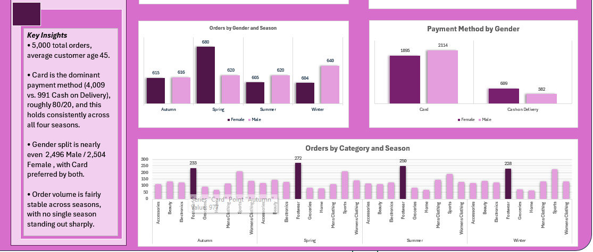
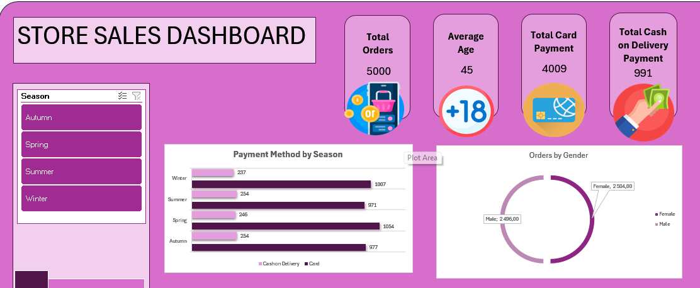
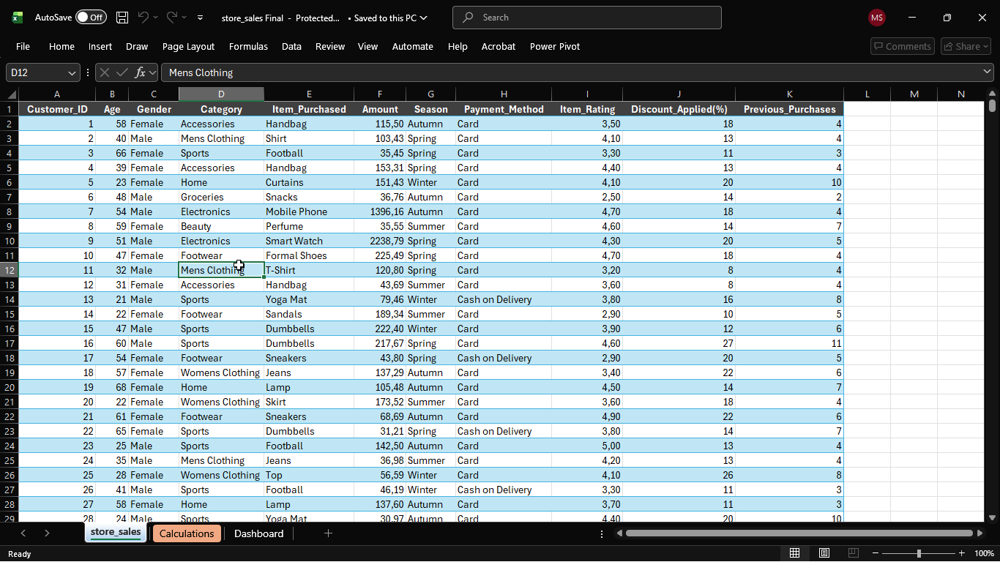
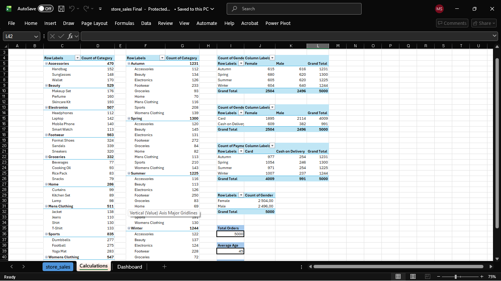
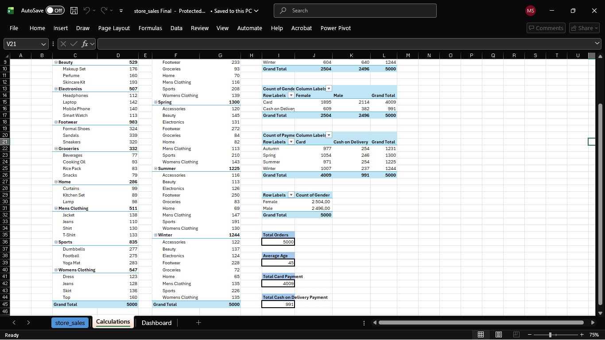

# Store Sales Analytics Dashboard — Excel

## Overview
An end-to-end Excel project analysing a 5,000-row retail transaction dataset (`store_sales.csv`, [source](https://www.kaggle.com/datasets/hassanjameelahmed/store-sales?select=store_sales.csv)). It covers customer demographics (`Customer_ID`, `Age`, `Gender`), purchase details (`Category`, `Item_Purchased`, `Amount`, `Season`, `Payment_Method`, `Item_Rating`, `Discount_Applied(%)`) and a loyalty signal (`Previous_Purchases`).

The project centres on one correctness question: does `Discount_Applied(%)` need to be applied to `Amount`, or is `Amount` already the final figure? Getting this wrong would have over- or understated revenue across the whole analysis, so resolving it properly was the core of the work.

## Dashboard

## Business Questions Addressed
- Is `Amount` the final transaction value, or does the discount need to be applied on top of it?
- How many orders were placed, and what is the average customer age?
- How do customers pay (Card vs Cash on Delivery), and does this change by season or gender?
- How are orders split by gender, season and category?

## Data Model
Built on a single flat table with one row per transaction (5,000 rows). PivotTables on a separate Calculations sheet feed the dashboard.

**Fields**
- **Customer:** Customer_ID, Age, Gender
- **Purchase:** Category, Item_Purchased, Amount, Season, Payment_Method
- **Rating and loyalty:** Item_Rating, Discount_Applied(%), Previous_Purchases

## Data Challenges and Decisions

### Does `Amount` already include the discount?
The same item appeared with very different `Amount` values. For example, "Handbag" appeared at 115.50 (18% discount) in one row and 153.31 (13% discount) in another. The first guess was that `Amount` is a discounted price derived from one fixed item price.

**Test:** a diagnostic column, `Implied_Original_Price = Amount / (1 - Discount_Applied% / 100)`, should have given roughly the same value for every row of the same item. A PivotTable of the Min and Max implied price per item showed the opposite:

| Item | Min implied price | Max implied price |
|---|---|---|
| Handbag | 21.86 | 261.13 |
| Headphones | 608.87 | 3,992.83 |
| Laptop | 568.52 | 4,148.19 |
| Smart Watch | 594.01 | 3,670.10 |
| Rice Pack | 6.97 | 107.28 |

This disproved the assumption: there is no fixed "original price" underneath `Amount`.

**Resolution:** instead of guessing, I checked the dataset's Kaggle description, which states that `Amount` is **"the total transaction value."**

**Decision:**
- `Revenue = Amount`, used directly with no adjustment. Applying the discount again would double-discount revenue.
- `Implied_Original_Price` was dropped once it had served its purpose, because keeping it would have implied it was a real figure.
- `Discount_Applied(%)` is treated as an independent, descriptive variable, not an input for recalculating `Amount`.

### Generic item labels
`Item_Purchased` names such as "Handbag" or "Laptop" cover very different price points, so the dataset does not support deriving a standard price per item. *Decision:* no per-item price is assumed anywhere in the analysis.

## Process
1. **Investigation:** tested the `Amount` vs discount question with the diagnostic column and Min/Max PivotTable, then resolved it against the source documentation.
2. **Verification:** built a Calculations sheet to cross-check every number before it reached the dashboard. Each breakdown reconciles to 5,000 orders:
   - Category (with item-level subtotals), Season (broken down by category), and Gender (Female 2,504 / Male 2,496)
   - Gender × Payment Method and Payment Method × Season
   - KPI totals checked against the pivot breakdowns
3. **Visualisation:** built the dashboard with PivotCharts and a Season slicer.

## Key Measures
| KPI | Definition |
|---|---|
| Total Orders | Count of orders (5,000) |
| Average Age | Average of `Age` (45) |
| Total Card Payment | Count of orders paid by card (4,009) |
| Total Cash on Delivery Payment | Count of orders paid by cash on delivery (991) |

The two payment KPIs count orders, not amounts of money.

## Dashboard Visuals
- KPI cards: Total Orders, Average Age, Total Card Payment, Total Cash on Delivery Payment
- Payment Method by Season (bar chart)
- Orders by Gender (donut)
- Orders by Gender and Season (clustered bar)
- Payment Method by Gender (bar chart)
- Orders by Category and Season (bar chart)

## Key Insights
- **5,000 total orders**, average customer age **45**, which points to an established rather than youth-skewed customer base.
- **Card is the dominant payment method** (4,009 vs 991 Cash on Delivery, roughly 80/20), and the split holds across all four seasons, so season does not meaningfully influence how customers pay.
- **Gender split is nearly even** (2,504 Female / 2,496 Male), with Card preferred by both.
- **Order volume is fairly stable across seasons**, with no single season standing out sharply.

## Limitations
- `Discount_Applied(%)` must not be used to adjust `Amount` anywhere in this dataset.
- The dataset is a single snapshot with no date range, so the seasonal patterns describe the `Season` field only, not a time-series trend.
- Findings describe this dataset only.

## Tools Used
Microsoft Excel (PivotTables, PivotCharts, slicers, helper-column hypothesis testing)

## Author
**Sello Mpho** · Bloemfontein, South Africa
[Portfolio](https://mpho-sello.vercel.app/) · [LinkedIn](https://www.linkedin.com/in/mpho-sello-692193241) · sellompho1601@gmail.com
